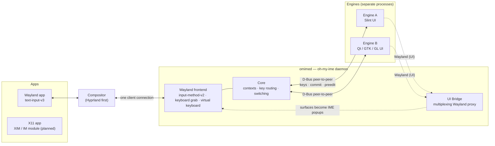

<div align="center">

# oh-my-ime

**A modern, Wayland-first, UI-agnostic input method platform for Linux.**

*The platform connects and delivers. The input method creates and expresses.*

English · [简体中文](README.zh-CN.md)

[](https://github.com/Ign1x/oh-my-ime/actions/workflows/ci.yml)
[](#license)
[](rust-toolchain.toml)
[](#compositor-support)

</div>

<p align="center">
  
  <br>
  <sub><a href="engines/sparkle">Sparkle</a>, a demo engine: its own Slint UI, turned into an input-method popup by oh-my-ime (foot on Hyprland).</sub>
</p>

> [!WARNING]
> **oh-my-ime is in early development.** It cannot replace your current input method yet.
> This README describes the architecture we are building, and the [status table](#status)
> says what works today. We would rather under-promise than claim compatibility we don't have.

## Why another input method framework?

On Windows (TSF) and macOS (IMKit), an input method is an **application**: it draws its own
candidate window, animates it, adds a settings panel, renders emoji grids or handwriting pads,
using whatever UI technology its authors like. The operating system only routes keys and
delivers text.

On Linux, Fcitx5 and IBus are excellent, but they are **frameworks**. They own the UI. Engines
publish candidates into a shared lookup table, and the framework renders one common candidate
window. If an engine wants something different, it has to fight the framework.

Wayland makes this harder:

- A seat accepts **one** input method (`zwp_input_method_v2`); every other one gets `unavailable`.
- A candidate popup must be a surface that belongs to **the same client connection** as that
  input method. Another process cannot simply create a window that follows the text cursor.
- XWayland apps don't speak `text-input` at all.

**oh-my-ime** is a platform built around these constraints:

- 🧩 **Input methods are independent processes.** Write them in Rust, C++, Python, anything.
- 🎨 **Their UI is theirs.** Use Slint, Qt, GTK, raw OpenGL or Vulkan. No mandatory candidate
  list, lookup table or theme engine.
- 🪄 **No toolkit patches.** A normal frameless window from your toolkit becomes the IME popup
  that follows the text cursor. The platform takes care of the Wayland plumbing.
- 🔌 **One daemon owns the compositor protocols.** It handles focus, keyboard grabs, key
  forwarding, switching and per-seat state, so engines don't have to.
- 🛡️ **Isolation.** An engine crash or hang never takes typing down with it.
- 🔁 **Compatibility hosts** for the existing IBus and Fcitx5 ecosystems are on the roadmap,
  clearly labelled as such.

## How it works



### The UI Bridge

The daemon keeps **one** connection to the compositor and owns `zwp_input_method_v2` on it.
Every engine gets a private Wayland socket served by the daemon, and the engine's toolkit
connects there as if it were the compositor. The daemon multiplexes all engine traffic onto its
own connection, built on [`wl-proxy`](https://crates.io/crates/wl-proxy). From the compositor's
point of view, the engine's surfaces belong to the input method, so the daemon may legally turn
them into input-method popups.

Engines create an ordinary frameless `xdg_toplevel`. The bridge answers the `xdg_shell`
protocol itself, assigns the input-popup role on the real compositor, keeps only the active
engine's popup visible, routes pointer input to the right engine, and cleans up after crashes.

### Engine protocol

Engine logic talks to the daemon over **peer-to-peer D-Bus**
(`io.github.ign1x.OhMyIme.Engine1` / `EngineHost1`). GLib, Qt, sd-bus and zbus speak it
natively, so engines don't need our SDK, though a Rust SDK is provided. Key events are answered
with an ordered list of actions (commit, preedit, delete-surrounding, forward), which keeps text
in sync with keystrokes. The platform never defines a candidate model.

See [docs/architecture.md](docs/architecture.md) for the full design.

## Status

| Area | State |
|---|---|
| Wayland frontend: `input-method-v2`, keyboard grab, virtual keyboard, key repeat | ✅ |
| Engine host: discovery, launch, supervision, crash restart, protocol v1 | ✅ |
| Rust SDK (`omime-sdk`) and the `echo` test engine | ✅ |
| Switching: hotkeys, `omime` CLI, D-Bus control API | ✅ |
| Password and PIN fields bypass engines | ✅ |
| UI Bridge: engine windows become IME popups (GPU and shm buffers, clicks, switching, HiDPI, crash cleanup) | ✅ sway and Hyprland |
| Demo engine with its own animated UI ([Sparkle](engines/sparkle), Slint) | ✅ |
| Config file, per-app memory, install/uninstall | 🚧 M4 / v0.2 |
| X11 / XWayland: XIM bridge, Fcitx IM-module protocol | 📅 Phase 2 |
| Hosting unmodified Fcitx5 / IBus (≥ 1.5.32) via a virtual `input-method-v2` | 📅 Phase 3 · 🧩 compat |
| Per-engine IBus and Fcitx5 addon hosts | 📅 Phase 4 · 🧩 compat |

✅ native support · 🧩 compatibility layer · 🚧 in progress · 📅 planned

## Compositor support

oh-my-ime targets compositors that implement `zwp_input_method_v2`, with input-popup support,
and `zwp_virtual_keyboard_v1`.

| Compositor | Protocols | Plan |
|---|---|---|
| **Hyprland** | IM v2 + popups + virtual keyboard | first target |
| sway ≥ 1.10, labwc, river, niri, COSMIC | IM v2 + popups | expected to work; sway is used for automated tests |
| KDE Plasma (KWin) | IM v1 only | needs an IM v1 frontend (later) |
| GNOME (Mutter) | no IM protocol (IBus D-Bus only) | not planned yet |

## Try it

oh-my-ime is a Rust workspace. The Nix dev shell provides every native dependency and
the compositors used for testing:

```sh
git clone https://github.com/Ign1x/oh-my-ime
cd oh-my-ime
nix develop                       # or: direnv allow
cargo build --workspace
```

Without Nix you need a Rust toolchain (pinned in `rust-toolchain.toml`), `pkg-config`,
and the development files of `wayland`, `libxkbcommon` and `dbus`.

Then, inside a Hyprland (or sway) session where no other input method is running:

```sh
PATH=$PWD/target/debug:$PATH OMIME_ENGINE_PATH=$PWD/engines omimed &
omime list                        # installed engines
omime switch sparkle              # or press Ctrl+Shift+Space
```

Type `:rocket` into any Wayland application and pick from Sparkle's deck; `omime switch
echo` selects the test engine, which commits words in UPPERCASE. `Ctrl+Space` toggles between direct input and the last engine,
`Ctrl+Shift+Space` cycles through engines, `omime status --json` feeds status bars.

To run omimed with Hyprland automatically, add `exec-once = omimed` to your Hyprland
configuration once it is installed in your `PATH`.

- Writing your own engine: [docs/writing-an-engine.md](docs/writing-an-engine.md)
- Hacking on oh-my-ime: [docs/development.md](docs/development.md)

## Roadmap

1. **Phase 0** — foundation ✅
2. **Phase 1 — Hyprland MVP** (`v0.1.0`)
   - M1: Wayland frontend + UI Bridge spike ✅
   - M2: engine host, protocol v1, Rust SDK, basic switching ✅
   - M3: complete UI Bridge + Slint demo engine ✅
   - M4: management and robustness
3. **v0.2** — per-app input method memory, install/uninstall/doctor CLI, multi-seat validation
4. **Phase 2** — X11/XWayland: XIM bridge and the Fcitx IM-module D-Bus protocol
5. **Phase 3** — host unmodified Fcitx5 / IBus through a virtual `input-method-v2`
6. **Phase 4** — per-engine IBus host and Fcitx5 addon host
7. **Phase 5** — native Rime engine, settings GUI, tray, more compositors, C ABI SDK

## FAQ

**Can I run oh-my-ime next to Fcitx5 or IBus?**
Not on the same seat. Wayland allows a single input method per seat. Phase 3 will let you run
Fcitx5 or IBus *inside* oh-my-ime as one switchable engine.

**Does my engine have to be written in Rust?**
No. The engine protocol is plain D-Bus and the UI is plain Wayland. The Rust SDK is a
convenience.

**Is everything 100% compatible with Fcitx5/IBus engines?**
No, and we won't claim that. Compatibility layers are labelled 🧩 and documented with their
known gaps.

## Contributing

Contributions are very welcome. Please read [CONTRIBUTING.md](CONTRIBUTING.md) first.

## License

oh-my-ime is licensed under either of

- Apache License, Version 2.0 ([LICENSE-APACHE](LICENSE-APACHE))
- MIT license ([LICENSE-MIT](LICENSE-MIT))

at your option.

Unless you explicitly state otherwise, any contribution intentionally submitted for inclusion
in this project by you, as defined in the Apache-2.0 license, shall be dual licensed as above,
without any additional terms or conditions.

The [Sparkle](engines/sparkle) demo engine uses [Slint](https://slint.dev) under the
Slint Royalty-free License; the platform itself does not depend on Slint.

[](https://slint.dev)
