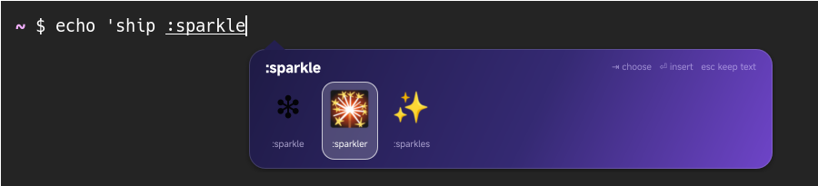
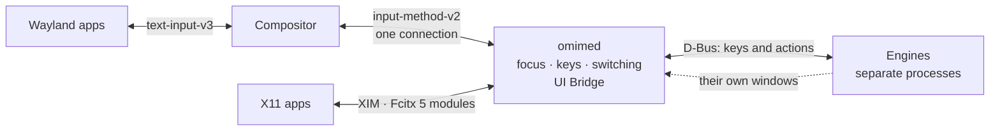

<div align="center">

# oh-my-ime

**A Linux input method platform where every input method is an app with its own UI.**

*The platform connects and delivers. The input method creates and expresses.*

English · [简体中文](README.zh-CN.md)

[](https://github.com/Ign1x/oh-my-ime/actions/workflows/ci.yml)
[](#license)
[](rust-toolchain.toml)
[](#desktop-support)

</div>

<p align="center">
  
  <br>
  <sub><a href="engines/sparkle">Sparkle</a>, a demo engine: its own Slint UI, turned into an input-method popup by oh-my-ime (foot on Hyprland).</sub>
</p>

## Purpose

On Windows and macOS, an input method is an application. It draws its own candidate window,
settings and animations with whatever UI technology its authors like; the system only routes
keys and delivers text. On Linux, Fcitx 5 and IBus are frameworks that own the UI: engines fill
a shared candidate list and the framework draws it. Wayland adds hard limits on top: one input
method per seat, and an input popup must belong to the input method's own connection.

oh-my-ime brings the Windows and macOS model to Linux. It is a platform, not another input
method: it connects input methods to applications and leaves the input experience to them.

> [!NOTE]
> oh-my-ime is in early development. It works on Hyprland and sway; KDE Plasma and GNOME are
> not supported yet ([desktop support](#desktop-support)).

## Design



- **One daemon, `omimed`,** owns what Wayland allows only once per seat: the compositor's
  `input-method-v2`, the keyboard grab and the virtual keyboard. It tracks focus, routes each key
  to the active input method, switches between input methods and delivers the text.
- **Input methods ("engines") are separate processes.** Their logic talks to omimed over
  peer-to-peer D-Bus, and each key is answered with an ordered list of actions: commit, preedit,
  delete surrounding text, forward the key. The platform defines no candidate model.
- **The UI Bridge** gives every engine a private Wayland socket and multiplexes it onto omimed's
  own compositor connection. An ordinary frameless window from any toolkit becomes the popup at
  the text cursor, without toolkit patches.
- **Applications** reach omimed through the compositor (`text-input-v3`); X11 applications
  through XIM or the Fcitx 5 GTK/Qt modules.
- **Fcitx 5 and IBus run inside oh-my-ime** as engines, unmodified, since a seat cannot have two
  input methods. 🧩

The full design is in [docs/architecture.md](docs/architecture.md).

## Features

- 🎨 **Any UI, any language.** Engines draw their own windows with Slint, GTK, Qt or OpenGL, in
  any language: the protocol is plain D-Bus and Wayland. A Rust SDK and a
  [Python/GTK 4 example](examples/python-gtk4) are included.
- 🀄 **A Rime engine.** [omime-rime](engines/rime) offers Xiaohe shuangpin and pinyin, horizontal
  or vertical candidates, light and dark themes, and a settings window.
- 🧩 **Fcitx 5 and IBus as engines.** Every input method inside them can be chosen on its own,
  next to the native engines, with their menus in the tray.
- 🛡️ **Resilient.** Keys go back to the application when an engine is slow, crashed engines
  restart, a misbehaving engine is stopped, and password fields that applications report
  bypass engines.
- 🧭 **A platform UI.** A settings app, a tray menu, a switcher, desktop notifications, the
  `omime` command line and a D-Bus API. The input method can be remembered per application.
- 🌐 **English and Simplified Chinese.**

## Desktop support

| Desktop | Support |
|---|---|
| Hyprland | ✅ |
| sway ≥ 1.10 and other compositors with `input-method-v2` (labwc, river, niri, …) | ✅ sway is tested; the others are expected to work |
| KDE Plasma | 📅 planned, through `input-method-v1` |
| GNOME | 📅 planned, through the IBus protocol |

On unsupported desktops, `omime setup` refuses before changing anything, and omimed exits
without disturbing the input method in use. Tested applications are recorded in
[docs/compatibility.md](docs/compatibility.md).

## Getting started

Install the prebuilt platform with Rime through Nix, on NixOS or any other distribution, then
configure Hyprland from a terminal in your Hyprland session:

```sh
nix profile install 'https://github.com/Ign1x/oh-my-ime/releases/latest/download/oh-my-ime-nix.tar.gz#full'
omime setup --engine rime --take-over --start
```

Log out and back in so applications inherit the input environment, then check with
`omime doctor`. `Ctrl+Space` toggles the input method, `Ctrl+Shift+Space` switches to the next
one, and `omime settings` opens the settings.

Installing from source, the NixOS and Home Manager modules, and undoing setup are covered in
the [setup guide](docs/setup.md), [releases](docs/releases.md), [Nix](docs/nix.md) and the
[Hyprland guide](docs/hyprland.md).

## Documentation

- [Architecture](docs/architecture.md)
- [Writing an engine](docs/writing-an-engine.md)
- [Application compatibility](docs/compatibility.md)
- [Development](docs/development.md) and [contributing](CONTRIBUTING.md)
- [Localization](docs/localization.md)
- [Changelog](CHANGELOG.md)

## License

Licensed under either of the [Apache License, Version 2.0](LICENSE-APACHE) or the
[MIT license](LICENSE-MIT), at your option. Unless you explicitly state otherwise, any
contribution intentionally submitted for inclusion in this project by you, as defined in the
Apache-2.0 license, shall be dual licensed as above, without any additional terms or conditions.

The Sparkle and Rime engines, the switcher (`omime-panel`, with `omime-overlay`) and the
settings (`omime-settings`) use [Slint](https://slint.dev) under the Slint Royalty-free License;
the daemon, the `omime` command line tool, the protocol crate and the SDK do not depend on
Slint.

[](https://slint.dev)
