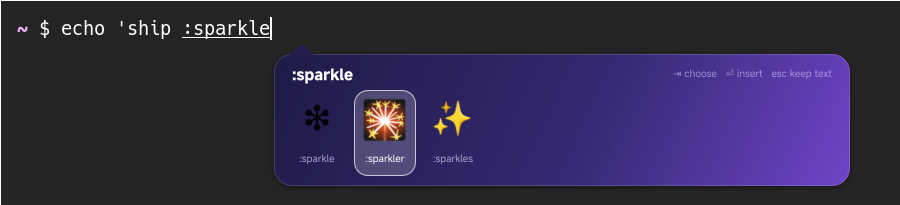
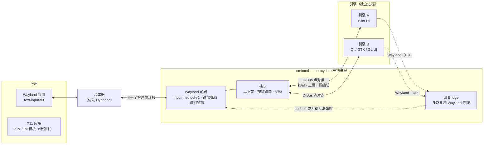

<div align="center">

# oh-my-ime

**现代化、Wayland 优先、与 UI 无关的 Linux 输入法平台。**

*平台负责连接与送达，输入法负责创造与表达。*

[English](README.md) · 简体中文

[](https://github.com/Ign1x/oh-my-ime/actions/workflows/ci.yml)
[](#许可证)
[](rust-toolchain.toml)
[](#合成器支持)

</div>

<p align="center">
  
  <br>
  <sub>示例引擎 <a href="engines/sparkle">Sparkle</a>：界面完全由它自己用 Slint 绘制，oh-my-ime 将其变成输入法弹窗（Hyprland 上的 foot 终端）。</sub>
</p>

> [!WARNING]
> **oh-my-ime 仍处于早期开发阶段，目前还不能替代你正在使用的输入法。**
> 本文介绍我们正在构建的架构；哪些功能已经可用，以[开发状态](#开发状态)表格为准。
> 我们宁可少承诺，也不宣称自己并不具备的兼容性。

## 为什么还要一个输入法框架？

在 Windows（TSF）和 macOS（IMKit）上，输入法是一个**应用**。它自己绘制候选窗口和动画，
提供设置面板，也可以渲染 emoji 网格、手写板，UI 技术由作者自由选择。
操作系统只负责路由按键、送达文字。

Linux 上的 Fcitx5 和 IBus 都很优秀，但它们是**框架**，UI 归框架所有。
引擎把候选词交给统一的查找表，再由框架用同一个候选窗口统一绘制。
引擎想做出不一样的界面，就得和框架对着干。

Wayland 让这件事更难：

- 一个 seat 只接受**一个**输入法（`zwp_input_method_v2`），其余的都会收到 `unavailable`。
- 候选弹窗所用的 surface 必须与该输入法属于**同一个客户端连接**。
  别的进程无法自己创建一个跟随文本光标的窗口。
- XWayland 应用根本不支持 `text-input`。

**oh-my-ime** 正是围绕这些约束设计的平台：

- 🧩 **输入法是独立进程**：可以用 Rust、C++、Python 或任何语言编写。
- 🎨 **UI 完全归输入法所有**：Slint、Qt、GTK、OpenGL、Vulkan 均可，
  不强制使用候选列表、查找表或主题引擎。
- 🪄 **无需修改 UI 工具包**：工具包创建的普通无边框窗口，会直接成为跟随文本光标的输入法弹窗。
  Wayland 层面的繁琐工作由平台完成。
- 🔌 **由一个守护进程持有合成器协议**：焦点、键盘抓取、按键回送、切换、每个 seat 的状态都由它处理，
  引擎无需关心。
- 🛡️ **隔离**：引擎崩溃或卡死都不会影响正常打字。
- 🔁 **兼容层**：IBus 与 Fcitx5 生态的兼容宿主已列入路线图，并会明确标注为兼容运行。

## 工作原理



### UI Bridge

守护进程与合成器之间只保持**一条**连接，并在这条连接上持有 `zwp_input_method_v2`。

每个引擎都会得到一个由守护进程提供的私有 Wayland socket。
引擎的 UI 工具包连接到这个 socket，就像连接到真正的合成器一样。
守护进程基于 [`wl-proxy`](https://crates.io/crates/wl-proxy)，把所有引擎的流量复用到自己的那条连接上。
因此在合成器看来，引擎的 surface 属于输入法客户端，守护进程可以合法地把它们设为输入法弹窗。

引擎只需创建一个普通的无边框 `xdg_toplevel`，其余工作由 Bridge 完成：

- 自行应答 `xdg_shell` 协议；
- 在真实合成器上为该 surface 设置输入法弹窗角色；
- 只显示当前激活引擎的弹窗；
- 把指针事件路由给正确的引擎；
- 引擎崩溃后负责清理现场。

### 引擎协议

引擎逻辑与守护进程之间通过 **点对点 D-Bus** 通信，接口为 `io.github.ign1x.OhMyIme.Engine1` 和 `EngineHost1`。

- GLib、Qt、sd-bus、zbus 都原生支持 D-Bus，引擎不依赖我们的 SDK 也能实现（我们同时提供 Rust SDK）。
- 引擎对每个按键的回复中，按顺序附带要执行的动作：上屏、预编辑、删除周边文本、回送按键。
  这样文本与按键的顺序始终一致。
- 平台从不规定候选词模型。

完整设计见 [docs/architecture.md](docs/architecture.md)（英文）。

## 开发状态

| 模块 | 状态 |
|---|---|
| Wayland 前端：`input-method-v2`、键盘抓取、虚拟键盘、按键重复 | ✅ |
| 引擎宿主：发现、启动、监护、崩溃重启、协议 v1 | ✅ |
| Rust SDK（`omime-sdk`）与 `echo` 测试引擎 | ✅ |
| 切换：热键、`omime` 命令行、D-Bus 控制接口 | ✅ |
| 密码与 PIN 输入框绕过引擎 | ✅ |
| UI Bridge：引擎窗口成为输入法弹窗（GPU 与 shm 缓冲、点击、切换、HiDPI、崩溃清理） | ✅ sway 与 Hyprland |
| 拥有独立动画 UI 的示例输入法（[Sparkle](engines/sparkle)，Slint） | ✅ |
| 配置文件、按应用记忆、安装/卸载 | 🚧 M4 / v0.2 |
| X11 / XWayland：XIM 桥、Fcitx IM 模块协议 | 📅 阶段 2 |
| 通过虚拟 `input-method-v2` 托管未修改的 Fcitx5 / IBus（≥ 1.5.32） | 📅 阶段 3 · 🧩 兼容 |
| 逐引擎的 IBus 宿主与 Fcitx5 插件宿主 | 📅 阶段 4 · 🧩 兼容 |

✅ 原生支持 · 🧩 兼容层 · 🚧 进行中 · 📅 计划中

## 合成器支持

oh-my-ime 面向同时实现了以下协议的合成器：
支持输入法弹窗的 `zwp_input_method_v2`，以及 `zwp_virtual_keyboard_v1`。

| 合成器 | 协议 | 计划 |
|---|---|---|
| **Hyprland** | IM v2 + 弹窗 + 虚拟键盘 | 首要目标 |
| sway ≥ 1.10、labwc、river、niri、COSMIC | IM v2 + 弹窗 | 预计可用；自动化测试使用 sway |
| KDE Plasma（KWin） | 仅 IM v1 | 需要 IM v1 前端（后续） |
| GNOME（Mutter） | 无 IM 协议（仅 IBus D-Bus） | 暂无计划 |

## 试用

oh-my-ime 是一个 Rust workspace。用 Nix 开发环境可以一次性获得全部原生依赖和测试用合成器：

```sh
git clone https://github.com/Ign1x/oh-my-ime
cd oh-my-ime
nix develop                       # 或：direnv allow
cargo build --workspace
```

如果不用 Nix，需要准备：

- Rust 工具链（版本固定在 `rust-toolchain.toml` 中）；
- `pkg-config`；
- `wayland`、`libxkbcommon`、`dbus` 的开发文件。

然后在没有运行其他输入法的 Hyprland（或 sway）会话中执行：

```sh
PATH=$PWD/target/debug:$PATH OMIME_ENGINE_PATH=$PWD/engines omimed &
omime list                        # 已安装的引擎
omime switch sparkle              # 或按 Ctrl+Shift+Space
```

在任意 Wayland 应用中输入 `:rocket`，然后从 Sparkle 的卡片中挑选。
`omime switch echo` 会切换到测试引擎，它把单词以大写形式上屏。

- `Ctrl+Space`：在直接输入和上一个引擎之间切换。
- `Ctrl+Shift+Space`：轮换引擎。
- `omime status --json`：可供状态栏使用。

把 omimed 安装到 `PATH` 后，在 Hyprland 配置中加入 `exec-once = omimed` 即可随 Hyprland 自动启动。

- 编写自己的引擎：[docs/writing-an-engine.md](docs/writing-an-engine.md)（英文）
- 参与开发：[docs/development.md](docs/development.md)（英文）

## 路线图

1. **阶段 0**：工程基础 ✅
2. **阶段 1：Hyprland MVP**（`v0.1.0`）
   - M1：Wayland 前端 + UI Bridge 验证 ✅
   - M2：引擎宿主、协议 v1、Rust SDK、基础切换 ✅
   - M3：完整 UI Bridge + Slint 示例输入法 ✅
   - M4：管理功能与健壮性
3. **v0.2**：按应用记忆输入法；安装/卸载/诊断命令；多 seat 验证
4. **阶段 2**：X11/XWayland：XIM 桥与 Fcitx IM 模块 D-Bus 协议
5. **阶段 3**：通过虚拟 `input-method-v2` 托管未修改的 Fcitx5 / IBus
6. **阶段 4**：逐引擎的 IBus 宿主与 Fcitx5 插件宿主
7. **阶段 5**：原生 Rime 引擎、设置界面、托盘、更多合成器、C ABI SDK

## 常见问题

**能和 Fcitx5 或 IBus 同时运行吗？**
同一个 seat 上不行，因为 Wayland 每个 seat 只允许一个输入法。
阶段 3 之后，你可以把 Fcitx5 或 IBus 作为一个可切换的引擎运行在 oh-my-ime **内部**。

**引擎必须用 Rust 写吗？**
不必。引擎协议就是普通的 D-Bus，UI 就是普通的 Wayland，Rust SDK 只是为了方便。

**和 Fcitx5/IBus 引擎 100% 兼容吗？**
不是，我们也不会这样宣称。兼容层都标注为 🧩，并在文档中写明已知的差距。

## 参与贡献

非常欢迎贡献！提交前请先阅读 [CONTRIBUTING.md](CONTRIBUTING.md)。

## 许可证

本项目采用以下任一许可证，由你自行选择：

- Apache License 2.0（[LICENSE-APACHE](LICENSE-APACHE)）
- MIT 许可证（[LICENSE-MIT](LICENSE-MIT)）

除非你另有明确声明，你有意提交并被本项目收录的任何贡献（依 Apache-2.0 许可证的定义），
均按上述双许可证授权，不附加任何其他条款或条件。

示例引擎 [Sparkle](engines/sparkle) 依据 Slint 免版税许可证使用 [Slint](https://slint.dev)；平台本身不依赖 Slint。

[](https://slint.dev)
