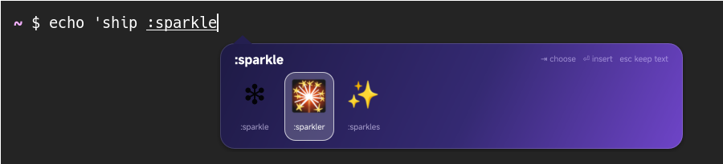
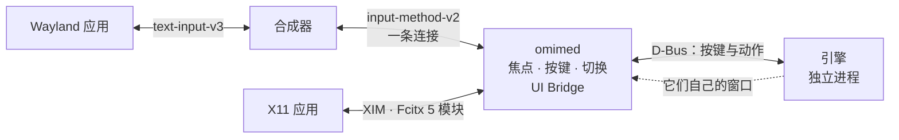

<div align="center">

# oh-my-ime

**让每个输入法都成为自带界面的应用：Linux 上的输入法平台。**

*平台负责连接与送达，输入法负责创造与表达。*

[English](README.md) · 简体中文

[](https://github.com/Ign1x/oh-my-ime/actions/workflows/ci.yml)
[](#许可证)
[](rust-toolchain.toml)
[](#桌面支持)

</div>

<p align="center">
  
  <br>
  <sub>示例引擎 <a href="engines/sparkle">Sparkle</a>：界面由它自己用 Slint 绘制，oh-my-ime 把它变成输入法弹窗（Hyprland 上的 foot 终端）。</sub>
</p>

## 用途

在 Windows 和 macOS 上，输入法是一个应用：候选窗、设置界面和动画都由它自己绘制，用什么 UI
技术由作者决定，系统只负责传递按键、送达文字。Linux 上的 Fcitx 5 和 IBus 是框架，界面归框架
所有：引擎把候选词交给统一的列表，由框架绘制。Wayland 还多了几条硬性限制：每个 seat 只能有
一个输入法，输入法弹窗必须属于输入法自己的连接。

oh-my-ime 把 Windows 和 macOS 的这种模式带到 Linux。它是一个平台，而不是又一个输入法：它负责
把输入法接到应用上，输入体验交给输入法自己。

> [!NOTE]
> oh-my-ime 仍处于早期开发阶段，目前支持 Hyprland 和 sway，尚不支持 KDE Plasma 和 GNOME
> （见[桌面支持](#桌面支持)）。

## 设计



- **一个守护进程 `omimed`**，持有 Wayland 规定每个 seat 只能有一份的东西：合成器的
  `input-method-v2`、键盘抓取和虚拟键盘。它跟踪焦点，把每个按键交给当前的输入法，负责在输入法
  之间切换，并把文字送达应用。
- **输入法（引擎）是独立进程。** 它的逻辑通过点对点 D-Bus 与 omimed 通信，对每个按键回复一串
  有序的动作：上屏、预编辑、删除周围文本、回送按键。平台不规定候选模型。
- **UI Bridge** 给每个引擎一个私有的 Wayland socket，并把它复用到 omimed 自己的合成器连接上。
  任何工具包创建的普通无边框窗口，都能成为跟随文本光标的弹窗，无需修改工具包。
- **应用**通过合成器（`text-input-v3`）连到 omimed；X11 应用通过 XIM 或 Fcitx 5 的 GTK/Qt 模块。
- **Fcitx 5 和 IBus 在 oh-my-ime 内部运行**，作为引擎，无需修改，因为一个 seat 不能同时有两个
  输入法。🧩

完整设计见 [docs/zh-CN/architecture.md](docs/zh-CN/architecture.md)。

## 特点

- 🎨 **界面和语言都不受限。** 引擎用 Slint、GTK、Qt 或 OpenGL 绘制自己的窗口，可以用任何语言
  编写：协议就是普通的 D-Bus 和 Wayland。附带 Rust SDK 和一个
  [Python/GTK 4 示例](examples/python-gtk4)。
- 🀄 **Rime 引擎。** [omime-rime](engines/rime) 提供小鹤双拼和拼音、横排或竖排候选、浅色和深色
  主题，以及设置窗口。
- 🧩 **Fcitx 5 和 IBus 作为引擎。** 它们里面的每个输入法都能单独选择，与原生引擎并列，菜单也在
  托盘里。
- 🛡️ **稳健。** 引擎响应慢时按键交还应用，崩溃的引擎会重启，行为异常的引擎会被停用，应用报告
  的密码框绕过引擎。XIM 应用停止响应超过 300 ms 后，会清理它的待发送输出，让其他应用继续输入。
- 🧭 **平台界面。** 设置程序、托盘菜单、切换浮层、桌面通知、`omime` 命令行和 D-Bus API，还能按
  应用记住输入法。
- 🌐 **英文和简体中文。**

## 桌面支持

| 桌面 | 支持情况 |
|---|---|
| Hyprland | ✅ |
| sway ≥ 1.10 及其他支持 `input-method-v2` 的合成器（labwc、river、niri……） | ✅ sway 已测试，其他预计可用 |
| KDE Plasma | 📅 计划中，通过 `input-method-v1` |
| GNOME | 📅 计划中，通过 IBus 协议 |

在不支持的桌面上，`omime setup` 会在改动任何东西之前拒绝执行，omimed 也会直接退出，不影响正在
使用的输入法。已验证的应用见 [docs/zh-CN/compatibility.md](docs/zh-CN/compatibility.md)。

## 快速开始

在 NixOS 或其他任何发行版上，用 Nix 安装预编译的平台和 Rime，然后在 Hyprland 会话的终端里配置
Hyprland：

```sh
nix profile install 'https://github.com/Ign1x/oh-my-ime/releases/latest/download/oh-my-ime-nix.tar.gz#full'
omime setup --engine rime --take-over --start
```

注销并重新登录，让应用继承输入环境，然后用 `omime doctor` 检查。`Ctrl+Space` 开关输入法，
`Ctrl+Shift+Space` 切换到下一个，`omime settings` 打开设置。

从源码安装、NixOS 和 Home Manager 模块、撤销配置，见[配置指南](docs/zh-CN/setup.md)、
[发布版本](docs/zh-CN/releases.md)、[Nix](docs/zh-CN/nix.md)和
[Hyprland 指南](docs/zh-CN/hyprland.md)。

## 文档

- [架构](docs/zh-CN/architecture.md)
- [编写引擎](docs/zh-CN/writing-an-engine.md)
- [应用兼容性](docs/zh-CN/compatibility.md)
- [开发](docs/zh-CN/development.md)与[贡献指南](CONTRIBUTING.md)
- [本地化](docs/zh-CN/localization.md)
- [更新日志](CHANGELOG.md)

## 许可证

本项目可任选以下任一许可证使用：[Apache License, Version 2.0](LICENSE-APACHE) 或
[MIT 许可证](LICENSE-MIT)。除非你明确声明，否则你有意提交并纳入本项目的任何贡献（按
Apache-2.0 许可证的定义），都将按上述方式双重许可，不附加任何其他条款或条件。

Sparkle 和 Rime 引擎、切换浮层（`omime-panel`，使用 `omime-overlay`）和设置程序
（`omime-settings`）按 Slint Royalty-free License 使用 [Slint](https://slint.dev)；守护进程、
`omime` 命令行工具、协议 crate 和 SDK 不依赖 Slint。

[](https://slint.dev)
