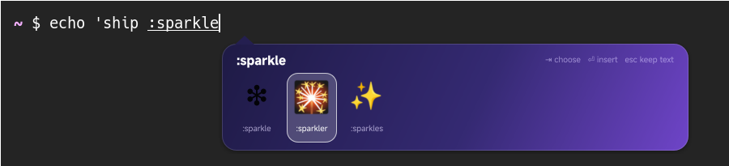

# Sparkle ✨

English · [简体中文](README.zh-CN.md)

An oh-my-ime engine that draws its own UI. Type `:` followed by a few letters of an
emoji's shortcode and pick from an animated deck that appears next to the text cursor.

Sparkle ships with the platform but is disabled by default. Try it with
`omime switch sparkle`, or add it to the hotkey cycle with `omime enable sparkle`
or **Add input method…** in the settings app. For first-run setup,
`omime setup --engine sparkle --start` enables and starts it.

| Key | Action |
|---|---|
| `:` then letters | start a query, e.g. `:rocket`, `:heart`, `:thumbs` |
| `Tab` / `→`, `Shift+Tab` / `←` | move the selection |
| `Space` / `Return` / click | insert the selected emoji |
| `Backspace` | edit the query; removing the colon ends it |
| `Esc` or any other key | keep what you typed as plain text |

Everything else you type passes through untouched.

## What it demonstrates

- **The UI is the engine's own.** The deck is an ordinary frameless
  [Slint](https://slint.dev) window with gradients, rounded corners, a drop shadow,
  animations, hover effects and a pointer cursor. oh-my-ime's UI bridge turns it into an
  input-method popup; Slint needs no special code.
- **Cursor awareness.** The platform reports where the text cursor is relative to the
  window, and the arrow follows it (and flips when the popup sits above the text).
- **Mouse input.** Clicks reach the engine, which commits through the SDK's `Host`.
- **Visibility is the platform's job.** The engine calls `set_popup_visible` instead of
  hiding its window.
- **Threading.** The engine logic runs on the SDK thread; the UI owns the main thread.
- **A menu and a floating panel.** Sparkle's menu (in the tray, or `omime properties`
  and `omime activate recent-panel`) turns on a panel at the bottom right of the screen
  with the emoji you inserted last; a click inserts one again, and the keyboard stays in
  the text field. The panel is a helper process, `omime-sparkle --panel`, on the
  compositor's display (`$OMIME_HOST_WAYLAND_DISPLAY`), drawn on a layer surface by
  `omime-overlay`; it is there while Sparkle serves a text field. Sparkle keeps the
  switch and the emoji in `$XDG_STATE_HOME/oh-my-ime/sparkle`.

## Rendering

Slint uses OpenGL (femtovg) by default, passing GPU buffers through the bridge.
If OpenGL is unavailable, select the software renderer explicitly by setting
`SLINT_BACKEND=winit-software` in omimed's environment before starting it.

Emoji glyphs use the "Noto Color Emoji" font when it is installed. The panel always
uses Slint's software renderer, which draws a glyph in one color only, so it draws its
emoji with swash into images (Noto Color Emoji, Twemoji and a few others are looked
for).

## License

Sparkle's own code is MIT OR Apache-2.0 like the rest of oh-my-ime. It uses Slint under
the [Slint Royalty-free License](https://github.com/slint-ui/slint/blob/master/LICENSES/LicenseRef-Slint-Royalty-free-2.0.md);
oh-my-ime's platform crates do not depend on Slint.

