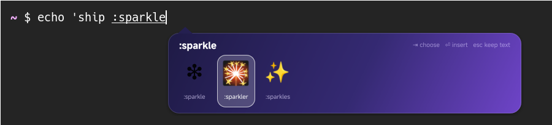

# Sparkle ✨

[English](README.md) · 简体中文

一个自绘界面的 oh-my-ime 引擎。输入 `:` 和表情短代码的前几个字母，即可从文本光标旁
弹出的动画卡片中选择表情。

Sparkle 随平台安装，但默认不启用。使用 `omime switch sparkle` 即可试用；运行
`omime enable sparkle`，或在设置应用中选择“添加输入法…”，可将它加入热键切换顺序。
首次配置时，`omime setup --engine sparkle --start` 会启用并启动它。

| 按键 | 操作 |
|---|---|
| `:` 后输入字母 | 开始查询，例如 `:rocket`、`:heart`、`:thumbs` |
| `Tab` / `→`、`Shift+Tab` / `←` | 移动选择 |
| `Space` / `Return` / 单击 | 插入选中的表情 |
| `Backspace` | 编辑查询；删掉冒号即结束查询 |
| `Esc` 或其他按键 | 将已输入的内容保留为普通文本 |

其他输入原样传递给应用。

## 演示的功能

- **引擎自行绘制界面。** 卡片是普通的无边框 [Slint](https://slint.dev) 窗口，包含渐变、
  圆角、阴影、动画、悬停效果和鼠标指针。oh-my-ime 的 UI 桥将其变成输入法弹窗，
  Slint 无需特殊适配。
- **感知光标位置。** 平台报告文本光标相对窗口的位置，箭头随之移动；弹窗位于光标上方时，
  箭头也会翻转。
- **鼠标输入。** 点击传给引擎，引擎通过 SDK 的 `Host` 提交文本。
- **平台管理可见性。** 引擎调用 `set_popup_visible`，无需自行隐藏窗口。
- **线程。** 引擎逻辑运行在 SDK 线程，UI 使用主线程。
- **菜单和悬浮面板。** 在 Sparkle 的托盘菜单中，或通过 `omime properties` 和
  `omime activate recent-panel`，可以打开右下角的最近使用表情面板。点击即可再次插入，
  键盘焦点仍留在文本框。面板由辅助进程 `omime-sparkle --panel` 绘制，使用合成器的
  显示连接（`$OMIME_HOST_WAYLAND_DISPLAY`），通过 `omime-overlay` 创建层表面；
  Sparkle 为文本框服务时显示。开关状态和表情保存在 `$XDG_STATE_HOME/oh-my-ime/sparkle`。

## 渲染

Slint 默认使用 OpenGL（femtovg）渲染，通过 UI 桥传递 GPU 缓冲区。
若 OpenGL 不可用，请在启动 omimed 前，在其环境中设置 `SLINT_BACKEND=winit-software`
显式选择软件渲染。

安装了“Noto Color Emoji”字体时，表情使用该字体。面板始终使用 Slint 的软件渲染器，
而它只能以单色绘制字形，因此面板通过 swash 将表情绘制成图片，会查找 Noto Color Emoji、
Twemoji 等字体。

## 许可证

Sparkle 自身代码与 oh-my-ime 其他代码一样采用 MIT OR Apache-2.0 许可证。
它依据 [Slint 免版税许可证](https://github.com/slint-ui/slint/blob/master/LICENSES/LicenseRef-Slint-Royalty-free-2.0.md)
使用 Slint；oh-my-ime 的平台 crate 不依赖 Slint。

